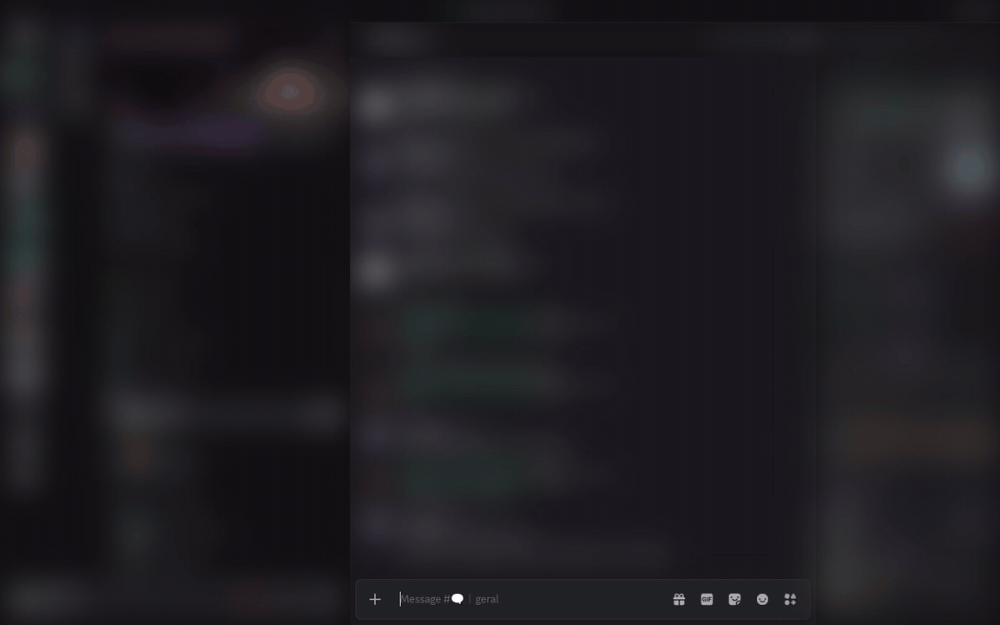

# Expanded Editor

[English](README.md) · **Português**

Um editor em tela cheia pro Discord, feito pra quem escreve post longo. Eu escrevo RP e ficção em canal de Discord faz anos, e a caixinha de mensagem nunca foi lugar pra isso. Então fiz um plugin pro [Vencord](https://vencord.dev) que abre uma página de escrita de verdade em cima do chat, com as cores do próprio Discord, e manda o texto pro canal quando você termina.



## Como usar

Abre pelo **+** da caixa de mensagem, em **Expanded editor**, ou com **Ctrl+Shift+O**. O editor abre com o que já tava escrito no chat, e tudo que você escreve volta pra caixa de mensagem quando fecha com **Esc**.

## Novidades

1. **Escrever e Pré-visualizar.** A pré-visualização mostra o texto exatamente como o Discord vai renderizar, na mesma linha onde você escreveu, sem pular nada. **Ctrl+Shift+P** alterna.
2. **Formatação.** Negrito, itálico, sublinhado, tachado, spoiler, código, título (aperta de novo pra diminuir), subtexto, citação, lista e travessão pra diálogo. **Ctrl+B**, **Ctrl+I** e **Ctrl+U** funcionam, e o **Ctrl+Z** desfaz tudo direitinho.
3. **Contagem.** Palavras, caracteres contra o limite do Discord e tempo de leitura, no rodapé.
4. **Meta de palavras.** Três metas que você ajusta nas configurações (1.000, 2.000 e 2.500 por padrão). Uma barrinha enche enquanto você escreve e avisa quando bate a meta.
5. **Modo calmo.** **Ctrl+Shift+F** some com tudo menos o texto. A linha que você tá escrevendo fica no meio da tela, e a barra de cima só volta quando mexe o mouse. **Esc** sai do modo calmo primeiro, depois fecha.
6. **Tipografia.** Quatro fontes (Discord, Serifada, Writer e Mono) e tamanho de 15 a 22 px, com a largura da linha ajustada pra cada uma. A Writer usa a iA Writer Quattro se você tiver instalada.
7. **Mensagem longa.** Passou do limite (2.000 caracteres, ou 4.000 com Nitro)? O botão vira **Send 2 messages** e o texto é dividido em parágrafo, depois linha, frase e palavra. Nunca corta no meio de bloco de código. Se você tava respondendo alguém, só a primeira mensagem vai como resposta.
8. **Slowmode.** Em canal com slowmode, o editor espera o tempo entre uma mensagem e outra e mostra a contagem no botão.
9. **Nada se perde.** O rascunho é o mesmo da caixa de mensagem e salva enquanto você escreve. Se o Vesktop fechar do nada, o editor reabre com o seu texto. Se um envio falhar no meio, o que já foi fica enviado e o resto continua no editor pra tentar de novo.
10. **Mensagens recentes.** Um painel do lado com as últimas mensagens do canal e um botão pra citar.

**Ctrl+Enter** envia.

## Instalação

Plugin de terceiro no Vencord precisa ser compilado junto com ele. Você vai precisar de [git](https://git-scm.com), [Node.js](https://nodejs.org) e [pnpm](https://pnpm.io).

```bash
git clone https://github.com/Vendicated/Vencord
cd Vencord
pnpm install --frozen-lockfile
git clone https://github.com/sum117/vencord-expanded-editor src/userplugins/expandedEditor
pnpm build
```

Depois:

- **Discord normal:** roda `pnpm inject` e escolhe a sua instalação.
- **Vesktop:** roda `echo {} > dist/package.json` (o Vesktop só aceita a pasta com esse arquivo), depois vai nas configurações do Vesktop, em **Developer Options → Vencord Location**, e escolhe a pasta `Vencord/dist`. Reinicia o Vesktop.

Ativa o **ExpandedEditor** nas configurações do Discord, em **Vencord → Plugins**, e pronto.

Pra atualizar:

```bash
cd Vencord
git -C src/userplugins/expandedEditor pull
pnpm build
```

E reinicia o Discord.

## Limitações

1. `:emoji:` personalizado não é convertido no envio, e não tem autocompletar de menção.
2. Anexos ficam na caixa de mensagem, o editor só manda texto.
3. O Discord corta rascunho em 4.500 caracteres, então a caixa de mensagem mostra só o começo de um post maior. O texto inteiro continua no editor.

## Desenvolvimento

Os testes rodam no Node 23 ou mais novo, sem dependência:

```bash
node --import ./test/resolve-ts.mjs --test test/
```

Licença GPL-3.0-or-later, igual ao Vencord.

Feito pra quem escreve post de 3 mil palavras num canal do Discord e não se arrepende de nada.
